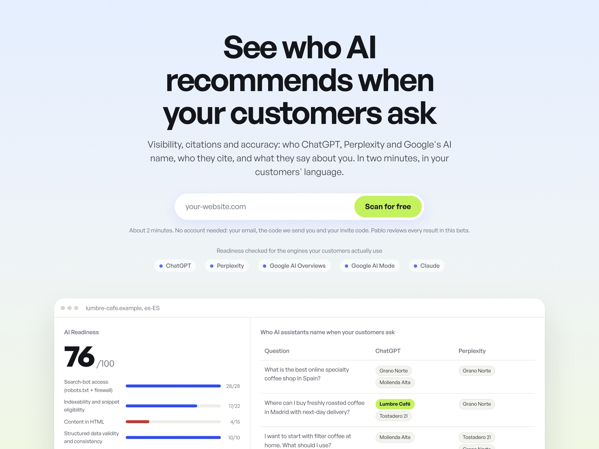
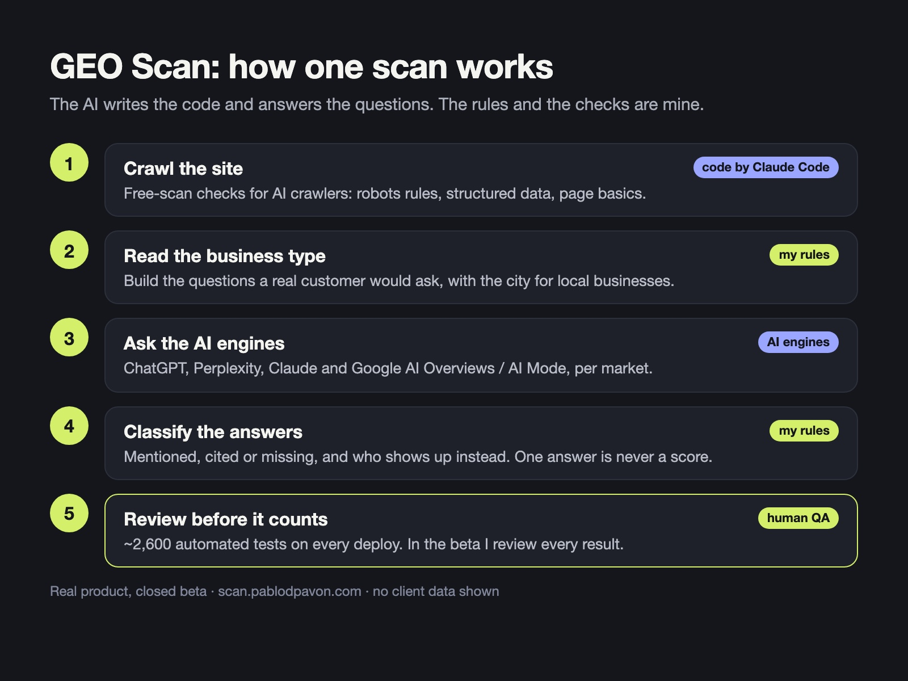
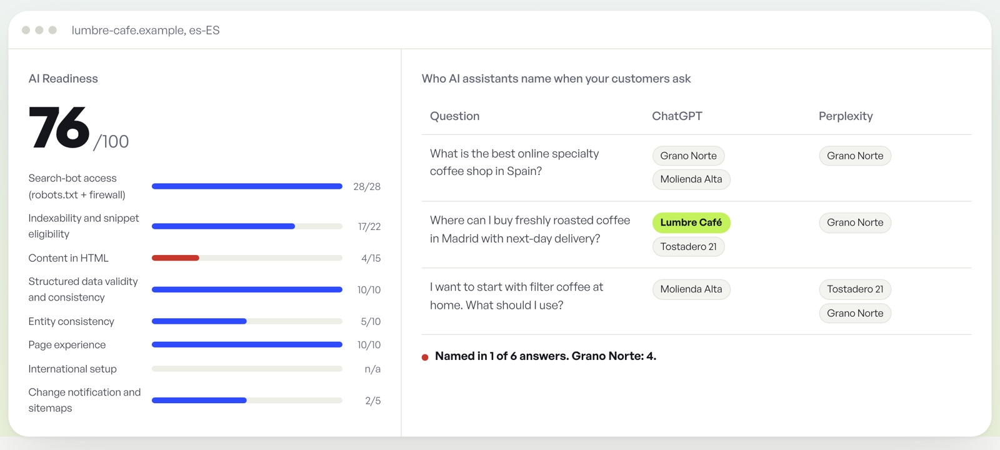

# GEO Scan: a small AI product, built and shipped in about ten days

**What it is.** A free scan that tells a business how visible it is when people ask AI assistants instead of Google. You enter your website, confirm your email, and a few minutes later you get a result page: which technical basics AI crawlers need are missing on your site, and how AI search engines actually answer questions a customer would ask about your type of business.

Live (closed beta, by invitation): https://scan.pablodpavon.com

**Why I built it.** I wanted to know whether I could take a product from idea to production with AI doing most of the coding, while I kept the parts that need judgment: the method, the rules, and checking every result before anyone sees it. I also wanted a real answer to a simple question: does ChatGPT even know a given business exists?

**How it works**

1. A crawler reads the site and runs the free-scan checks (robots rules for AI bots, structured data, page basics, business profile signals). The full method has 70+ checks; the free scan runs a subset.
2. The scan reads the business type from the site and builds questions a real customer would ask, with the city when it is a local business.
3. Those questions go to AI search engines through their APIs, and to Google through a SERP provider to capture AI Overviews. The code supports ChatGPT search, Perplexity, Gemini, Claude and Google AI Overviews / AI Mode, configured per market.
4. The answers are classified (is the business mentioned, cited, or missing; who shows up instead), and the result page explains the findings in plain language.
5. Every scan also sends me a control email. In the beta, I review each result.

*The example on the landing page uses a fictional business (lumbre-cafe.example).*

**What I did and what the AI did.** The code (Python, FastAPI, SQLite, deployed on a Hetzner server behind Cloudflare) was written with Claude Code. I wrote the method, the scoring and disclosure rules, the wording of every finding, and the acceptance criteria. Nothing went to production without passing both test suites and a checklist I signed off: backup first, deploy, then a file-by-file checksum comparison between my machine and the server.

**Quality in numbers**
- About 2,600 automated tests (1,919 for the pipeline, 693 for the web app), run on two Python versions before every deploy.
- Four languages in the interface: English and Spanish complete, German and Hebrew partly hidden until a native speaker reviews them. I don't ship text in a language nobody has checked.
- Anti-abuse limits, email verification and a bot check on the form, because the scan calls paid APIs.

**What I learned**
- AI writes code fast, so the bottleneck moves to deciding what "correct" means. Most of my time went into rules and test cases, not code.
- One AI answer is not a measurement. The scan labels its sample as indicative and never averages engines into one score.
- Translation is part of quality. The Hebrew interface stayed hidden until a native speaker reviewed it, and German is still partly hidden for the same reason.

**Status.** Closed beta, by invitation. Not open for sign-ups yet.

---

The product code lives in a private repository. This repository holds the case study only.

Pablo Pavon · Business & Data Analyst, Berlin · [pablodpavon.com](https://pablodpavon.com) · [LinkedIn](https://www.linkedin.com/in/pablo-damian-pavon) · [Upwork](https://www.upwork.com/freelancers/pablopavon)
